

  

  
  
  
  

 


  

  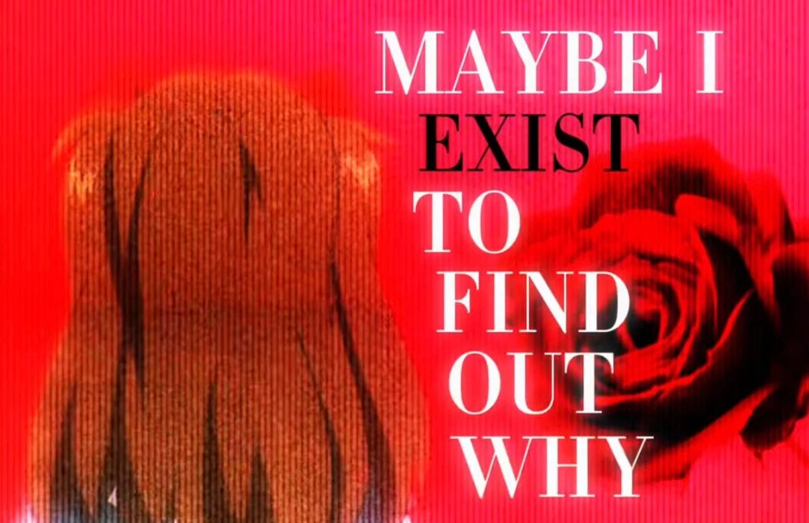

 


  <a href="https://github.com/Ra9ge/application.senku.all"></a>
  <a href="https://github.com/Ra9ge/Game-language-changer"></a>

  <a href="https://github.com/Ra9ge/Uw.Senku.Site"></a>
  <a href="https://github.com/Ra9ge/senku.rs.model"></a>

  <a href="https://github.com/Ra9ge/Ra9ge.github"></a>
  <a href="https://github.com/Ra9ge/auto-play-anime-senku"></a>

 


  
   
  
   
  

 


  

  

  <picture>
    <source media="(prefers-color-scheme: dark)" srcset="https://raw.githubusercontent.com/Ra9ge/Ra9ge/output/snake-dark.svg">
    <source media="(prefers-color-scheme: light)" srcset="https://raw.githubusercontent.com/Ra9ge/Ra9ge/output/snake-light.svg">
    
  </picture>

  

 


  
  
  

  

